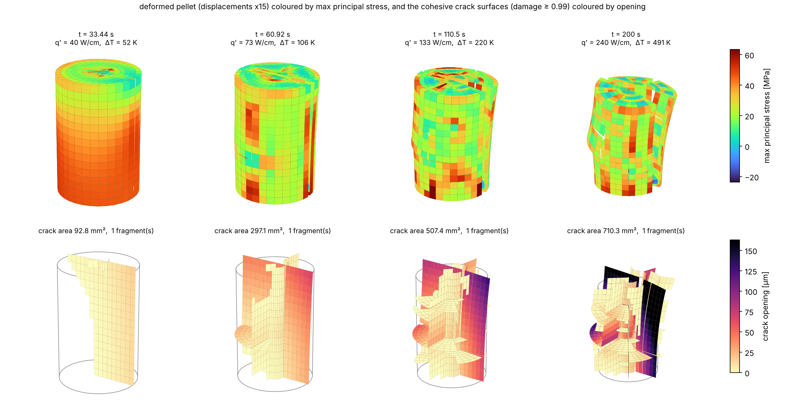
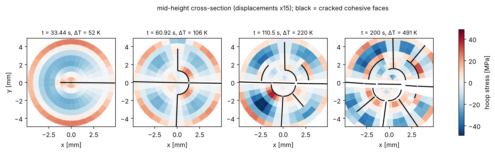
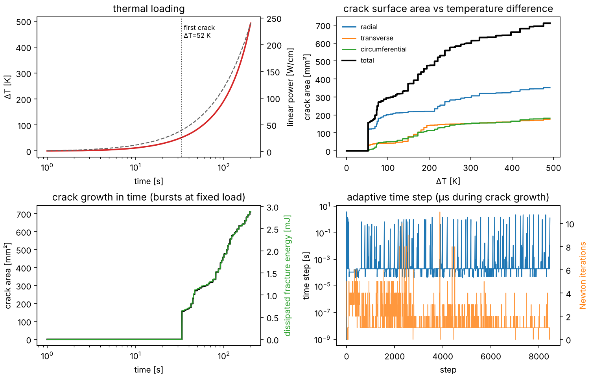

# pelletcz — 3D cohesive-zone fracture of UO₂ fuel pellets with Weibull statistics

A parallel C++17 finite-element code for thermal cracking of oxide fuel pellets and pellet stacks, built
on the method of **Williamson & Knoll, *Simulating Dynamic Fracture in Oxide Fuel Pellets Using Cohesive
Zone Models*, SMiRT-20 (2009), paper 1775**, and extended for

* **Weibull-distributed fracture properties**: strength *and* toughness vary in space, drawn from a
  mesh-independent correlated random field, so a crack runs through regions of different toughness;
* **convergence studies on crack surface area**, with a Grid Convergence Index analysis;
* **full 3D** single pellets and **two-pellet stacks** for *sympathetic cracking*, with pressing boundary
  conditions that constrain the stack without over-constraining it, so interface **friction** and
  **pressure** can be studied;
* **parallel computation**: OpenMP-threaded assembly, smoothed-aggregation AMG–preconditioned CG
  solvers and random-field generation; MPI ensembles for Weibull realisations and parameter sweeps.

The study tooling (run directories, convergence/GCI analysis, Weibull study, stack study, Sobol
campaign → PySR metamodel → predictor) follows the design of
[peridynamic-pellet-fracture](https://github.com/RizgarMella/peridynamic-pellet-fracture), so results
from the two methods can be compared directly.

> **Status.** The solver, tests and study planners are complete and the verification tests pass. The
> studies themselves have **not** been run; the pictures below come from one simple single-pellet run on a
> coarse mesh (see [Demo](#demo-single-pellet-power-up)). The two-pellet model is covered by the
> pressed-stack verification test and a short heated smoke run, not by a full sympathetic-cracking run.

---

## What the model does

| Ingredient | Implementation | Paper (W&K 2009) |
|---|---|---|
| Geometry | cylinder, R = 4.67 mm, H = 14 mm (no dish/chamfer); 1 or 2 pellets stacked | same |
| Mesh | structured polar hexahedra (trilinear, 2×2×2 Gauss; wedges at the axis) | Abaqus 3D, first order |
| Potential crack paths | zero-thickness 4+4-node cohesive interfaces on radial, transverse and circumferential planes; `radial_planes = all` frees the crack angle | radial + transverse (3D) |
| Cohesive law | penalty K = 10¹⁶ N/m³, linear (triangular) or exponential softening; σ_t = 130 MPa, G_c = 4 J/m² (means) → δ_f = 0.0615 µm | same |
| Statistics | **Weibull** σ_t and G_c on a Gaussian random field of correlation length l_c (or per element with weakest-link scaling); flaws; strength–toughness correlation ρ | deterministic, seeded flaws |
| Regularisation | Abaqus-type viscous damage, μ = 10⁻⁴ s | same |
| Crack faces | full-penalty compression, Coulomb friction after damage, gap + radiation heat transfer | same (no friction) |
| Thermal | transient conduction, k(T, Bu) from Fink (2000) × Lucuta (1996), c_p(T) Fink, uniform heating, h = 5000 W/m²K to 500 K coolant | same |
| Mechanics | small-strain thermo-elasticity, thermal + MATPRO solid/gaseous swelling eigenstrains | same |
| Coupling, time | staggered thermal → mechanical per step; implicit, adaptive steps from µs (crack bursts) to days | fully coupled, implicit |
| Pellet stack | unilateral penalty contact + Coulomb friction (or stick) at end faces, dish/contact-fraction gaps, solid + gas conductance | — |

Cracks are **predefined paths** with cohesive surfaces; where along them cracks initiate, how far they
run, whether they arrest and how they interact is part of the solution. The predefined-path assumption
is the main modelling limitation (see [Limitations](#limitations)); `radial_planes = all` together with
many transverse planes moves towards the "cohesive everywhere" approach of Xu & Needleman (1994).

### Weibull fracture properties

Each cohesive integration point gets a strength σ_t and a fracture energy G_c:

* A standard Gaussian field ξ(**x**) with covariance exp(−|Δ**x**|²/l_c²) is generated on a background grid
  (separable convolution of white noise, OpenMP-parallel) that does **not** depend on the FE mesh.
* U = Φ(ξ) is mapped through the Weibull quantile σ_t = σ_u + σ₀ (−ln(1−U))^{1/m}, with σ₀ set so the
  *mean* equals the input (and likewise for G_c with its own modulus).
* Toughness uses ξ_G = ρ ξ + √(1−ρ²) ξ₂, so ρ = 1 makes strong regions tough, ρ = 0 decouples them.
* Refining the mesh therefore samples the *same* material, which is what makes crack-area convergence
  studies meaningful. With `correlation_length = 0` each interface element draws independently, with
  optional weakest-link scaling σ₀(A_ref/A_el)^{1/m}; the convergence study compares both.
* Local flaws (`weibull.flaws`) reproduce the paper's "seeded" initiation sites, or seed a crack at a
  known angle in a stack.

### Boundary conditions for pressed pellets

The aim is to hold the stack without generating artificial reactions, so that friction and interface
pressure are the only things that couple the pellets.

* **Bottom** (`boundary.bottom`):
  * `roller`: u_z = 0, frictionless. This is the symmetry plane of an infinite stack.
  * `platen`: a rigid support plane with penalty contact and Coulomb friction (`platen_friction`).
* **Top** (`boundary.top`):
  * `pressure(t)`: the plenum-spring load.
  * `displacement(t)`: a rigid frictionless platen. Use it to impose closure and read the axial force
    from `top_reaction_N`.
* **In-plane rigid-body modes**: three statically determinate pins on one region (u_x, u_y at an axis
  node, u_y at the adjacent node on the x axis).
  * They carry no load for self-equilibrated thermal loading.
  * `pin_reaction_N` in `history.csv` checks this at every step.
* **Fragments** that detach completely are kept solvable by a matrix-only residual stiffness (no force is
  added to the residual).
* **Pellet–pellet interface**:
  * unilateral contact, with friction μ ∈ [0, ∞) or `stick`;
  * contact restricted to an annulus by `contact_fraction`, or by an explicit `dish_radius`/`chamfer`;
  * reported every step: normal force, mean/max pressure, contact area, slip fraction and shear force.
  * `interface_NNNN.csv` maps pressure, shear, gap and slip at every interface point.

### Numerics and parallelism

* **Nonlinear solve:** modified Newton with the symmetric secant interface matrix, which stays positive
  definite through softening, plus backtracking line search and stagnation detection.
* **Linear solve:** PCG preconditioned by smoothed-aggregation AMG.
  * Rigid-body near-nullspace for elasticity, constant for heat.
  * Chebyshev smoothing.
  * OpenMP SpGEMM on every level; dense Cholesky on the coarsest.
  * The hierarchy is reused until the iteration count rises, then rebuilt.
  * About 25–40 iterations per solve to 10⁻⁶, against ~1,300 for block-Jacobi on a 30 k-dof pellet.
  * Newton solves are inexact: PCG to 10⁻³ of the current residual. This is 35 % faster than 10⁻⁶ and
    changes crack area by < 0.5 %.
* **Time stepping:** adaptive.
  * A step is rejected and cut if Newton fails, or if the viscous damage jumps by more than
    `max_damage_increment` anywhere.
  * While cracks grow unstably, dt ≤ 2μ.
  * Crack initiation is approached by extrapolating the failure index (max δ/δ₀ over intact points).
  * Steps range from ~10⁻⁴ s during crack bursts to `dt_max` in steady operation (cf. Fig. 6 of the paper).
* **Parallelism:**
  * Shared memory: OpenMP throughout (assembly with atomic scatter, AMG setup and cycles, PCG, field
    generation, metrics).
  * Distributed: `mpirun -n R pelletcz --ensemble cases.txt` spreads independent cases (Weibull seeds,
    mesh levels, factorial designs) over ranks or nodes, each case using OpenMP threads.
  * The study planners also write Slurm array scripts.

---

## Build

```bash
cmake -S . -B build -DCMAKE_BUILD_TYPE=Release        # finds OpenMP and (optionally) MPI
cmake --build build -j
cd build && ctest --output-on-failure                 # verification tests (≈ 10 s)
```

Requires a C++17 compiler; OpenMP and MPI are optional (`-DPELLETCZ_USE_MPI=OFF`,
`-DPELLETCZ_NATIVE=ON` for `-march=native`). There are no other dependencies. The Python tools need
`pip install -r tools/requirements.txt` (PySR optional).

## Run

```bash
OMP_NUM_THREADS=8 ./build/pelletcz inputs/single_pellet_demo.ini            # single pellet
./build/pelletcz inputs/single_pellet_demo.ini mesh.nr=24 weibull.seed=3    # any key can be overridden
./build/pelletcz inputs/two_pellet_sympathetic.ini                          # two pressed pellets
./build/pelletcz --dry-run inputs/two_pellet_sympathetic.ini                # mesh / dof counts only
mpirun -n 4 ./build/pelletcz --ensemble cases.txt --threads 8               # many cases in parallel
python tools/render.py runs/single_pellet_demo                              # figures (matplotlib)
```

Every key is documented in [docs/INPUT_REFERENCE.md](docs/INPUT_REFERENCE.md). Output files open in
ParaView (`bulk.pvd`, `surface.pvd`, `cracks.pvd`).

### Outputs (run directory)

Every output is self-describing, and column names carry units.

| file | content |
|---|---|
| `manifest.json` | all inputs, build id (sha256 of the sources + git revision), labels, derived quantities (dofs, ζ = l_cz/h, δ₀, δ_f, sampled σ_t range) |
| `history.csv` | one row per accepted step, ~35 columns (see below) |
| `bulk_NNNN.vtu` | hex mesh: displacement, temperature, stress tensor, max principal / hoop / radial / axial / von Mises stress, fragment id |
| `surface_NNNN.vtu` | outer and end faces only (light-weight rendering) |
| `cracks_NNNN.vtu` | every cohesive / contact face: damage, viscous damage, opening, σ_t, G_c, tractions, dissipated energy, plane id |
| `angular_NNNN.csv` | damage vs angle in the element layers at the bottom, mid-height and top of each pellet (crack alignment) |
| `interface_NNNN.csv` | pellet-pellet contact: pressure, shear, gap, sliding flag per integration point |
| `fragments.csv` | fragments: regions joined by intact ligaments, with volume, d_eq and centroid |
| `outputs.csv` | output index → time |
| `summary.json` | written last; `"complete": true` only for finished runs; onset, crack area by kind and by plane, fragment statistics, L_eq = 3V/A |

`history.csv` columns, one row per accepted step:

* **Loading:** power, burnup.
* **Temperatures:** T_centre, T_surface, ΔT, T_max.
* **Cracks:** total crack area, and by radial / transverse / circumferential plane and by pellet;
  damaged area; dissipated energy; fragment count.
* **Stress:** max principal stress.
* **Pellet interface:** force, contact area, mean/max pressure, slip fraction, shear force.
* **Reactions:** top, bottom and pin reactions.
* **Solver effort:** Newton, PCG and thermal iterations; residual; wall time.

---

## Verification

`ctest` runs `tests/test_main.cpp`:

| test | result |
|---|---|
| triangular law δ_f = 2G_c/σ_t (paper §3: 0.0615 µm), peak traction = σ_t, work of separation = G_c, secant unloading, compression penalty, viscous lag | exact |
| Coulomb friction, contact opening, dish gap | exact |
| Weibull sampler: mean and CV (m = 6) | < 0.3 % / 1 % |
| Gaussian field: unit variance, correlation e⁻¹ at lag l_c | ±5 % |
| interface counts and coincident node pairs for a 2-pellet mesh with radial, transverse and circumferential planes | exact |
| steady centre temperature rise q′/(4πk) | 0.3 % (polygonal section) |
| mid-plane hoop stress vs. analytic parabolic-T solution αEΔT(3ρ²−1)/(4(1−ν)) | 3.6 % RMS |
| **structural tension test across a cohesive plane**: peak force = σ_t·A, dissipated energy = G_c·A, zero force after separation, through snap-back | 0.01 % / 0.0 % |
| **pressed two-pellet stack**: contact force = bottom reaction = p·A, contact confined to the annulus, pins carry nothing (< 10⁻⁵ p·A) | 0.001 % |

---

## Demo: single pellet power-up

`inputs/single_pellet_demo.ini` reproduces the paper's power-up step: 0 → 240 W/cm in 200 s, h = 5000 W/m²K
to 500 K coolant, free surfaces, no cladding.

**Model.**
* Coarse mesh: nr = 8, n_θ = 32, n_z = 16 → 4,096 hexes, 32 k displacement dofs.
* 4,352 cohesive interfaces on 8 radial planes, 7 transverse planes and circumferential surfaces at 0.25,
  0.5 and 0.75 R.
* Weibull strength and toughness, m = 8, means 130 MPa and 4 J/m².
* Correlated field, l_c = 0.5 mm, ρ = 0.5. The sampled σ_t ranged from 36 to 178 MPa.

**Cost.** 8,457 steps (107 rejected), 72 min on 2 cores. Build `src-ec97febaba28-git-376cdb8`.







**Initiation.**
* The first crack initiates at **ΔT = 52 K** (q′ = 40 W/cm).
  * The surface hoop stress there is ≈ 87 MPa, so the crack starts in a weak region of the Weibull field.
  * The deterministic paper models first crack at 80 K (axisymmetric) and 88 K (3D).
* The crack then runs unstably at fixed load, over ~0.1 s of µs-scale steps (lower-right panel).
  * It cuts the full height and passes through the axis, so the pellet opens along a diameter.
  * This is the behaviour the paper reports for its single-seed plane-strain case (Fig. 7d). Without a
    cladding to stop the pellet opening, one dominant early crack controls what follows.

**Further cracking with power.**
* More radial cracks, then circumferential and transverse cracks, appear in bursts as ΔT rises
  (upper-right panel).
* By 240 W/cm (ΔT = 491 K) **710 mm²** is cracked:
  * all 8 radial planes (352 mm²);
  * all 7 transverse planes, unevenly (176 mm²);
  * the 0.25 R and 0.5 R circumferential surfaces (182 mm²).
* The crack network relieves the stress. The largest principal stress anywhere is 65 MPa, against
  ≈ 820 MPa at the surface of an uncracked elastic pellet.
* Intact ligaments still hold every piece together, so there is 1 fragment; L_eq = 3V/A = 4.1 mm.
* The stress field after cracking is strongly non-uniform, as the paper concludes.
* The rigid-body pins carried < 1.1 N throughout. They held the body without loading it.

**Resolution caveat.** This mesh has ζ = l_cz/h ≈ 0.06, so the cohesive zone is far from resolved.
Treat the picture as qualitative; the convergence study (Q1) is what turns it into numbers.

Reproduce:

```bash
OMP_NUM_THREADS=8 ./build/pelletcz inputs/single_pellet_demo.ini
python tools/render.py runs/single_pellet_demo --frames 9,30,51,72 --warp 15
```

---

## Studies

The four study scripts share one workflow: **plan → run → analyze → plot**.

* `plan` writes a self-contained study directory under `studies/<name>/`:
  * `study.json`, `cases.csv`;
  * `cases.txt` for the MPI ensemble, `jobs/jobs.tsv`, `jobs/slurm_array.sh`;
  * `DATASET_CARD.md`.
* Run it any of three ways; all are resumable, and complete runs are skipped:
  * locally with `tools/study_common.py run`;
  * with `mpirun … --ensemble`;
  * on Slurm.
* `analyze` writes tidy tables to `derived/`, each with a `.meta.json` sidecar listing columns, units and
  sources. `plot` makes figures only from `derived/`.

```bash
python tools/mesh_convergence.py plan --seeds 4          # Q1: crack-area convergence
python tools/study_common.py run studies/meshconv --parallel 2 --threads 8
python tools/mesh_convergence.py analyze studies/meshconv && python tools/mesh_convergence.py plot studies/meshconv
```

### Q1 Mesh convergence on crack surface area (`tools/mesh_convergence.py`)

**Design.** Levels nr = 6 … 36. n_θ and n_z scale with nr and keep every potential crack plane, so all
levels see the same crack layout. Three families:

* `field`: a correlated Weibull field of fixed l_c. This is the main test: the material is the same at
  every level.
* `element`: independent draws per element with weakest-link scaling.
* `constant`: no scatter.

**Loading.** A heating ramp to 400 W/cm.

**Metrics.**
* Crack area A(ΔT*) at ΔT* = 100…400 K. Crack bursts happen at fixed load, so A is taken *after* all
  growth at that load.
* Dissipated energy, onset ΔT, fragments, number of radial planes cracked.
* ζ = l_cz/h, with l_cz ≈ EG_c/σ_t² ≈ 52 µm. Turon et al. (2007) recommend ζ ≈ 3; the paper found
  engineering accuracy from ζ ≈ 0.7.

**Analysis.**
* Celik et al. (2008) GCI on the three finest levels, with iterative order p and Richardson extrapolation.
* Seed-noise test: |φ₁ − φ₂| ≤ 2 combined SEM.
* The coarsest level within 10 % of the extrapolated A(300 K) is written to `derived/convergence.json`,
  which the campaign reads.

### Q2 Weibull statistics (`tools/weibull_study.py`)

**Design.** m ∈ {no scatter, 4, 6, 8, 12, 20} × l_c ∈ {per element, 0.25, 0.5, 1 mm} × seeds. The mean
strength and toughness are fixed, so only the spread and its spatial structure change.

**Outputs.**
* Onset ΔT: mean, CV and bootstrap CI.
* A Weibull fit of the onset across seeds. Its modulus, compared with the input m, shows how much
  material scatter survives the weakest-link selection by the stress field.
* Crack area, fragments, and radial planes cracked.

### Q3 Sympathetic cracking between pressed pellets (`tools/stack_study.py`)

**Stack.** Two pellets:
* Pellet 0 has a weak flaw at θ = 0 near its upper face.
* Pellet 1 can crack on every radial element boundary (`radial_planes = all`).
* Loading: preload by top pressure, then heat and hold.

**Factors.** Pressure {0, 2, 10, 30} MPa × friction {0, 0.2, 0.5, 1, stick} × contact fraction
{1, 0.75, 0.5}. Every combination has a matched **control** with no flaw. A one-factor-at-a-time design
is the default.

**Metrics.**
* Crack area per pellet.
* **Sympathetic excess**: pellet-1 crack area minus the control.
* Cross-interface **alignment** of the end-face damage profiles:
  * Pearson r;
  * enrichment = P(pellet-1 crack within ±w of a pellet-0 crack mouth) / (circumferential fraction
    within ±w). 1 means independent; above 1 means seeded.
* Interface pressure, slip and shear.

### Q4 Metamodel (`tools/campaign.py` → `tools/fit_pysr.py` → `tools/predict_fragments.py`)

**Design.** A scrambled Sobol campaign of 128 training + 32 validation runs over geometry, material
distributions (including Weibull m, l_c and ρ) and power histories, including the paper's +50 % ramp.

**Features.** Dimensionless groups, computed by `tools/features.py`:
* Π_T = αEΔT₀/((1−ν)σ̄);
* Π_R = R/l_ch;
* Π_H, Π_lc, m, ν, ρ;
* ramp rate / diffusion time, second-ramp fraction, burnup.

**Targets.** Specific crack area, fragment count, L_eq/R, and Π_T at onset.

**Fit.** PySR symbolic regression:
* every Pareto equation is scored on the validation split;
* the Occam choice is the simplest equation within 5 % of the best;
* a gradient-boosting baseline shows what the closed form gives up;
* each model is saved as a JSON card used by the predictor, which warns on extrapolation.
* `fit_pysr.py --learning-curve` decides whether `campaign.py plan --extend` is worth running.

---

## Limitations

* **Predefined crack paths.** Cracks can only form on the chosen planes. Results depend on that choice;
  use `radial_planes = all` and more slabs to reduce the bias. Stress can exceed σ_t away from any plane;
  the paper notes the same issue and suggests combining with a smeared-crack model.
* **Small strain and small sliding.** Contact pairs are node-to-node conforming, so both pellets need the
  same angular mesh. This is fine for µm-scale slips.
* **Material.** Linear elastic UO₂ with no creep, so there is no cool-down cracking from relaxed stresses.
  There is no densification or relocation, and no cladding: free radial surface, convective cooling as in
  the paper. Pellet–clad interaction is the natural next step.
* **Coupling.** Thermal and mechanics are staggered within a step (`solver.coupling_iterations` adds
  passes), not monolithic.
* **Cohesive resolution.** At the demo resolution ζ ≈ 0.06, far below the ζ ≈ 3 Turon et al. recommend.
  Crack paths and onset are meaningful; crack lengths and areas need the convergence study.
* **Cost of crack bursts.** Unstable growth is resolved on the viscous time scale (dt ~ 2μ), so run time
  scales with the cracked area. The demo spent most of its 72 min in bursts. Time a coarse level before
  launching a sweep.
* **Parallelism.** MPI parallelises *cases*, not one solve. The largest single model is bounded by one
  node's memory: about 2 M dofs on a 64 GB node.

## Repository

| path | purpose |
|---|---|
| `src/` | solver: mesh with crack-plane regions (`mesh.*`), cohesive/contact law (`interface_law.*`), Weibull fields (`random_field.*`), UO₂ properties (`materials.*`), thermal / mechanics / time stepping (`thermal.cpp`, `mechanics.cpp`, `solver.cpp`), AMG (`amg.*`), block-CSR + PCG (`sparse.*`), outputs (`output.cpp`) |
| `tests/` | verification tests (ctest) |
| `docs/images/` | demo figures (rendered by `tools/render.py`) |
| `inputs/` | `single_pellet_demo.ini`, `two_pellet_sympathetic.ini` |
| `tools/` | `pczio.py` readers, `render.py` figures, `study_common.py`, `mesh_convergence.py`, `weibull_study.py`, `stack_study.py`, `campaign.py`, `features.py`, `fit_pysr.py`, `predict_fragments.py` |
| `docs/INPUT_REFERENCE.md` | every input key |

## References

* Williamson R.L., Knoll D.A. (2009) Simulating dynamic fracture in oxide fuel pellets using cohesive zone models. SMiRT-20, Espoo, paper 1775.
* Dugdale (1960); Barenblatt (1962); de Borst (2003) Eng. Fract. Mech. 70; Planas et al. (2003) Eng. Fract. Mech. 70.
* Turon A. et al. (2007) An engineering solution for mesh size effects in the simulation of delamination using cohesive zone models. Eng. Fract. Mech. 74.
* Xu X.P., Needleman A. (1994) Numerical simulations of fast crack growth in brittle solids. JMPS 42.
* Fink J.K. (2000) Thermophysical properties of uranium dioxide. JNM 279; Lucuta P.G. et al. (1996) JNM 232; Allison C.M. et al. (1993) MATPRO, NUREG/CR-6150; Olander (1976).
* Vaněk P., Mandel J., Brezina M. (1996) Algebraic multigrid by smoothed aggregation. Computing 56.
* Celik I.B. et al. (2008) Procedure for estimation and reporting of uncertainty due to discretization in CFD applications. J. Fluids Eng. 130.
* Cranmer M. (2023) Interpretable machine learning for science with PySR. arXiv:2305.01582.
